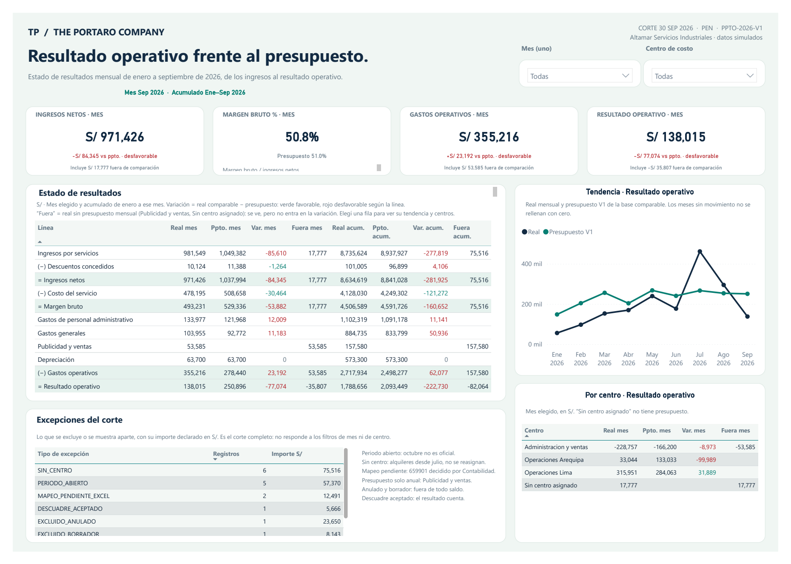

# Altamar Servicios Industriales — Estado de resultados mensual

Demo con datos sintéticos, enero a septiembre de 2026, en soles. Una página, 8 tablas,
31 medidas DAX. Fuentes: ERP contable exportado a 5 CSV, Excel de mapeo
cuenta → línea y Excel de presupuesto.

## Abrir en Power BI Desktop

1. Abrir `reporte/altamar-fin-01.pbip`.
2. En Transformar datos → Editar parámetros, cambiar **DataFolder** por la ruta absoluta
   de la carpeta `datos/modelo` de esta entrega (sin el nombre de un archivo).
3. Actualizar y guardar. Elegir otro mes y un centro de costo; hacer clic en una fila del estado.

Desktop consume el modelo preparado en los 7 CSV. Actualizar no transforma las fuentes RAW:
modificarlas requiere un nuevo proceso ETL. No necesita SQL, Pro, gateway ni credenciales.

## Qué comprobar

Sin filtros la página muestra septiembre de 2026, todos los centros:

| Indicador | Real | Presupuesto | Variación |
|---|---:|---:|---:|
| Ingresos netos | S/ 971,425.79 | S/ 1,037,994.05 | −S/ 84,345.46 |
| Margen bruto | S/ 493,231.14 | S/ 529,335.65 | −S/ 53,881.71 |
| Gastos operativos | S/ 355,216.38 | S/ 278,440.00 | S/ 23,191.84 |
| Resultado operativo | S/ 138,014.76 | S/ 250,895.65 | −S/ 77,073.55 |

Acumulado enero–septiembre: resultado operativo S/ 1,788,655.74 contra S/ 2,093,449.04
presupuestado. La variación compara solo el real que tiene presupuesto mensual; lo demás se ve aparte como
«Fuera de comparación». Reglas e indicadores completos en `documentacion/`.

La comprobación previa en el motor comparó 5,850 valores en 90 combinaciones de
mes, centro y ventana con un cálculo independiente desde las fuentes RAW. La copia portable cambia únicamente
el parámetro DataFolder y excluye cachés. La imagen incluida es el render PNG del PDF exportado desde Power BI Desktop; el PDF original va al lado.
Se publica el proyecto descargable; no es un enlace interactivo del servicio Power BI.

## PDF e imagen

- [PDF original de Power BI Desktop](capturas/altamar-fin-01-desktop.pdf)
- [Imagen del reporte](capturas/altamar-fin-01-desktop.png)
- [Ficha de galería ES/EN](ficha-galeria.json)

## Open in Power BI Desktop

Open `reporte/altamar-fin-01.pbip`, then set **DataFolder** under Transform data → Edit parameters to the absolute path of
this folder’s `datos/modelo`. Refresh and save. Synthetic data, January to September 2026, in soles (PEN).
Desktop reads the prepared model CSV files; it does not transform RAW sources. Variance compares only actuals
with a monthly budget; the rest is shown apart as outside the comparison.
