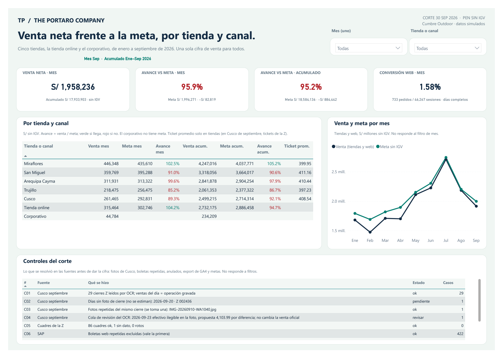
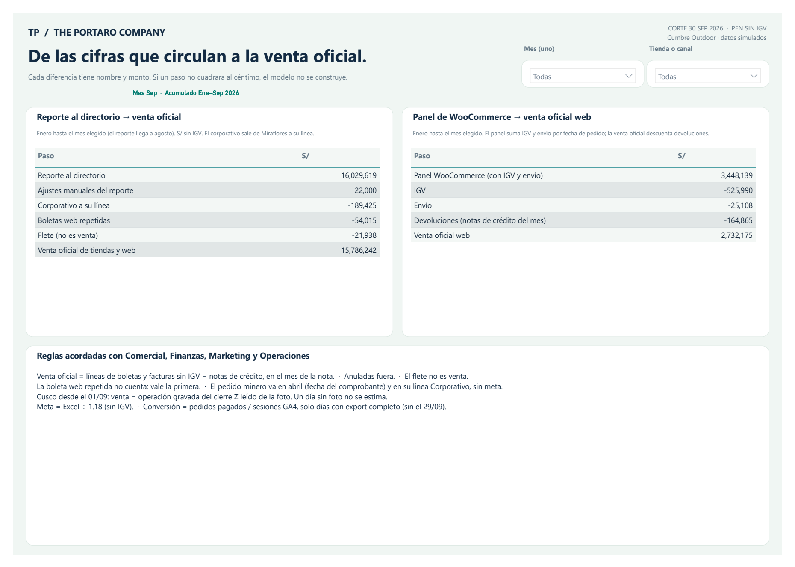

# Cumbre Outdoor — Ventas omnicanal frente a la meta

Demo con datos sintéticos, enero a septiembre de 2026, en soles sin IGV. Dos páginas, 7 tablas,
33 medidas DAX. Fuentes: ERP al estilo SAP Business One (export de SQL Server a CSV), pedidos de
la API de la tienda online (WooCommerce), export de Google Analytics 4, tres Excel y las fotos del cierre Z de
Cusco de septiembre.

## Abrir en Power BI Desktop

1. Abrir `reporte/cumbre-com-04.pbip`.
2. En Transformar datos → Editar parámetros, cambiar **DataFolder** por la ruta absoluta
   de la carpeta `datos/modelo` de esta entrega (sin el nombre de un archivo).
3. Actualizar y guardar. Elegir otro mes y una tienda o canal; abrir la página Conciliación.

Desktop consume el modelo preparado en los 7 CSV. Actualizar no vuelve a leer el ERP, la API ni las
fotos: cambiar las fuentes RAW requiere un nuevo proceso ETL. No necesita SQL, Pro, gateway ni credenciales.

## Qué comprobar

Sin filtros la página muestra septiembre de 2026, todas las unidades: venta neta S/ 1,958,236.19,
acumulado enero–septiembre S/ 17,933,902.50, avance contra la meta 95.9 % en el mes
y 95.2 % en el año (tiendas y web; el corporativo no tiene meta).

| Unidad | Venta neta sep. | Meta sep. | Avance |
|---|---:|---:|---:|
| Miraflores | S/ 446,348.34 | S/ 435,610.17 | 102.5 % |
| San Miguel | S/ 359,768.77 | S/ 395,288.14 | 91.0 % |
| Arequipa Cayma | S/ 311,930.95 | S/ 313,322.03 | 99.6 % |
| Trujillo | S/ 218,475.02 | S/ 256,474.58 | 85.2 % |
| Cusco | S/ 261,464.93 | S/ 292,830.51 | 89.3 % |
| Tienda online | S/ 315,463.86 | S/ 302,745.76 | 104.2 % |
| Corporativo | S/ 44,784.32 | — | — |

La conciliación lleva el reporte al directorio a S/ 15,786,241.63 (venta oficial de tiendas y web, enero–agosto)
y el panel de WooCommerce a S/ 2,732,175.41 (venta oficial web, enero–septiembre), paso a paso.
Cusco de septiembre sale de las fotos del cierre Z; el 20/09 no tiene foto y no se estima.
Reglas e indicadores completos en `documentacion/`.

La comprobación previa en el motor comparó 576 valores en 72 combinaciones
de mes y unidad con un cálculo independiente, y probó claves, montos y filtros del modelo. La copia portable
cambia únicamente el parámetro DataFolder y excluye cachés. Las imágenes son el render PNG del PDF exportado
desde Power BI Desktop; el PDF original va al lado. Se publica el proyecto descargable; no es un enlace
interactivo del servicio Power BI.

## PDF e imágenes

- [PDF original de Power BI Desktop](capturas/cumbre-com-04.pdf)
- [Ficha de galería ES/EN](ficha-galeria.json)

## Open in Power BI Desktop

Open `reporte/cumbre-com-04.pbip`, then set **DataFolder** under Transform data → Edit parameters to the absolute path of
this folder’s `datos/modelo`. Refresh and save. Synthetic data, January to September 2026, in soles (PEN)
excluding VAT. Desktop reads the prepared model CSV files; it does not re-read the ERP, the API or the photos.
The second page reconciles the board report and the online store dashboard with official sales, step by step.
