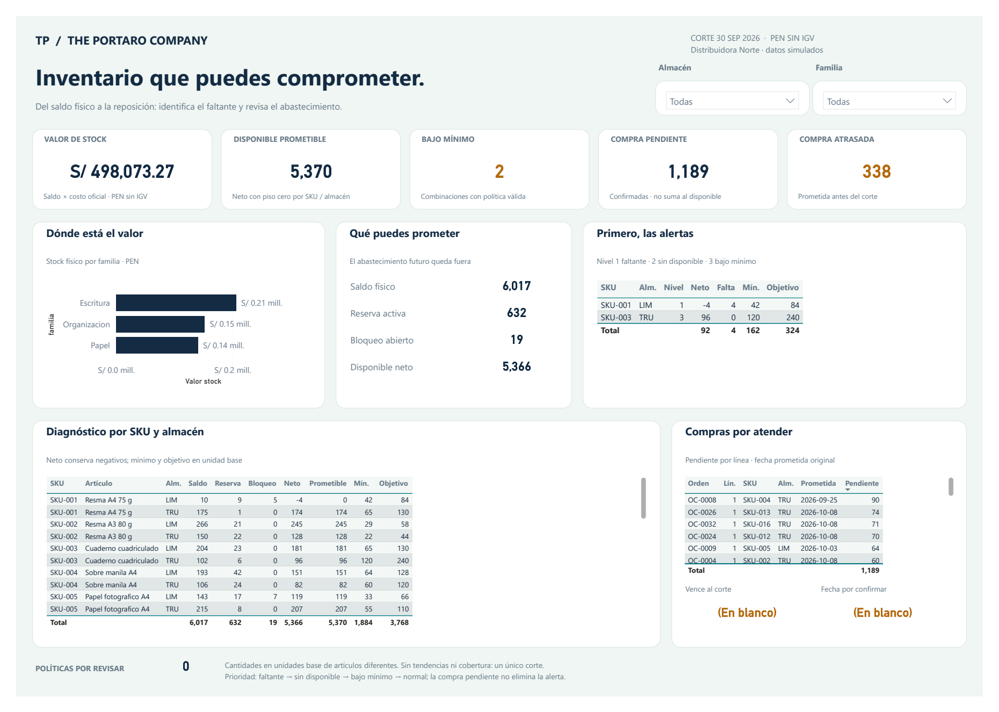

# Distribuidora Norte — Inventario y disponibilidad

Demo con datos sintéticos al 30/09/2026. Una página, cinco tablas, seis relaciones y 19 medidas DAX.
ERP relacional exportado a 12 CSV, políticas manuales en Excel y registro físico CSV.

## Abrir en Power BI Desktop

1. Abrir `reporte/norte-ops-01-v2.pbip`.
2. En Transformar datos → Editar parámetros, cambiar **DataFolder** por la ruta absoluta
   de la carpeta `datos/modelo` de esta entrega (sin el nombre de un archivo).
3. Actualizar y guardar. Probar los filtros Almacén y Familia y restablecerlos.

Desktop consume el modelo preparado en los cinco CSV. Actualizar no transforma las fuentes RAW:
modificarlas requiere un nuevo proceso ETL. No necesita SQL, Pro, gateway ni credenciales.

## Qué comprobar

Sin filtros: saldo 6.017, valor S/ 498.073,27, prometible 5.370, dos combinaciones
bajo mínimo y compra pendiente 1.189. Neto 5.366 y faltante 4 se conservan por combinación.
El disponible prometible es MAX(saldo − reserva activa − bloqueo abierto, 0) por SKU/almacén.
Compras: solo confirmadas menos recepciones contabilizadas al corte.
Reglas completas y explicación de indicadores en `documentacion/`.

La comprobación previa del motor concilió 1.412 controles RAW/modelo/DAX; apertura, actualización, guardado y filtros se comprobaron en Desktop. La copia portable cambia únicamente el
parámetro DataFolder y excluye cachés; aún no se ha refrescado esta copia en otra máquina.
Se incluyen el **PDF exportado de Power BI Desktop** y su render PNG; la previsualización HTML anterior conserva su etiqueta. El PDF corresponde a la revisión v2 guardada en Desktop (11/10/2026), con títulos y cabeceras completos; las dos tarjetas sin filas al corte muestran «En blanco».
No hay histórico suficiente para rotación, cobertura ni proyecciones. Se publica el proyecto descargable; no es un enlace interactivo del servicio Power BI.

## PDF e imagen

- [PDF original de Power BI Desktop](capturas/norte-ops-01-v2.pdf)
- [Imagen nativa renderizada del PDF](capturas/norte-ops-01-v2-desktop.png)
- [Ficha de galería ES/EN](ficha-galeria.json)

## Open in Power BI Desktop

Open `reporte/norte-ops-01-v2.pbip`, then set **DataFolder** under Transform data → Edit parameters to the absolute path of this folder’s `datos/modelo`. Refresh and save. Data is synthetic, at 2026-09-30 cutoff. Desktop reads the prepared model CSV files; it does not transform RAW sources. The portable copy has not been refreshed on a different machine. The PDF is the v2 revision saved in Desktop (2026-10-11), with full titles and headers; the two cards with no eligible rows at cutoff show “(Blank)”.

