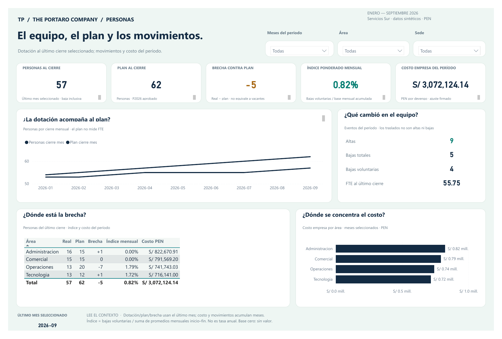

# Servicios Sur — Dotación y rotación

Demo sintética de RRHH. Una página Power BI, ocho tablas, quince relaciones y
diecisiete medidas DAX. Fuentes HRIS CSV, planillas CSV y Excel de planificación.

## Abrir y usar

1. Abrir `reporte/sur-hr-01.pbip` en Power BI Desktop.
2. Transformar datos → Editar parámetros: configurar **DataFolder** con la ruta
   absoluta de `datos/modelo` de esta entrega, sin nombre de archivo.
3. Actualizar y guardar. Filtrar Meses, Área y Sede; restablecer para ver todo.
4. Personas/plan/brecha/FTE de tarjeta muestran el último mes seleccionado.
   Costo, altas y bajas acumulan meses; el índice es ponderado mensual.

Desktop importa los ocho CSV preparados: no ejecuta ETL sobre las fuentes RAW.
No requiere SQL, Pro, Fabric, gateway ni credenciales. Cambiar RAW requiere volver
a preparar y validar el modelo. No hay servicio online ni actualización programada.

## Comprobaciones

Septiembre: 57 personas, FTE 55,75, plan 62 y brecha −5. Enero-septiembre:
9 altas, 5 bajas, 4 voluntarias y S/ 3.072.124,14 de costo. Índice ponderado mensual
0,82 %. Las reglas y cada indicador están en `documentacion/`.

El motor original pasó 3.187 comprobaciones en 187 contextos contra una referencia
RAW independiente; apertura, actualización y guardado se comprobaron en Desktop.
La copia portable cambia únicamente DataFolder y excluye cachés; aún no se ha
refrescado esta copia en otra máquina.

`capturas/sur-hr-01.pdf` es el export original de Desktop; el PNG se renderizó
desde ese PDF. Se conservan los pequeños iconos grises del export y el color
similar de ambas series. Empresa y personas son ficticias. Se publica el proyecto
descargable; no es un enlace interactivo del servicio Power BI.

## PDF e imagen

- [PDF original de Power BI Desktop](capturas/sur-hr-01.pdf)
- [Imagen renderizada del PDF](capturas/sur-hr-01.png)
- [Ficha de galería ES/EN](ficha-galeria.json)

## Open in Power BI Desktop

Open `reporte/sur-hr-01.pbip`, then set **DataFolder** under Transform data → Edit parameters to the absolute path of
this folder’s `datos/modelo`. Refresh and save. Synthetic data, January to September 2026, in soles (PEN); company and
people are fictional. Desktop reads the eight prepared model CSV files; it does not transform RAW sources. Headcount,
plan, gap and FTE show the last selected month; cost, hires and exits add up across months. The portable copy has not
been refreshed on a different machine. The original PDF is preserved unchanged, including small grey icons.
